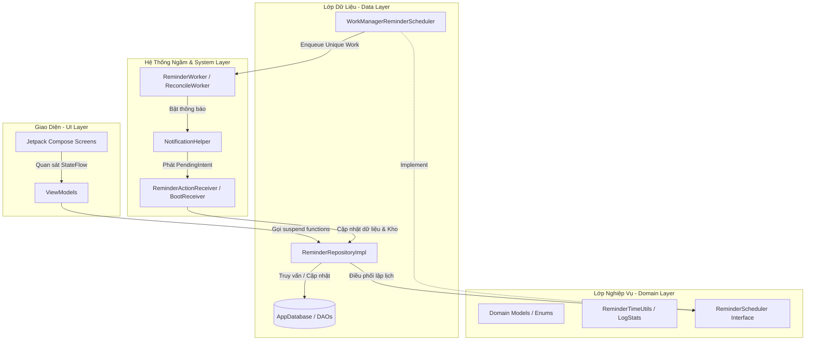
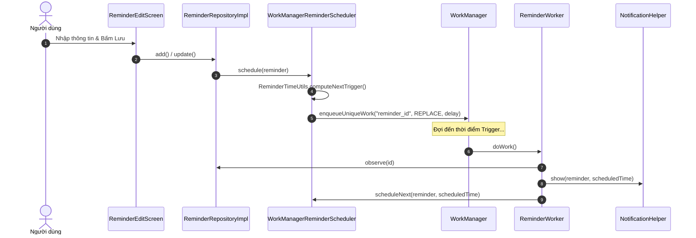
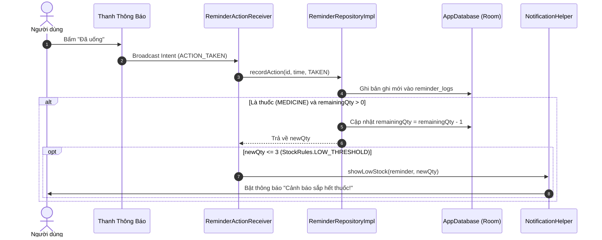
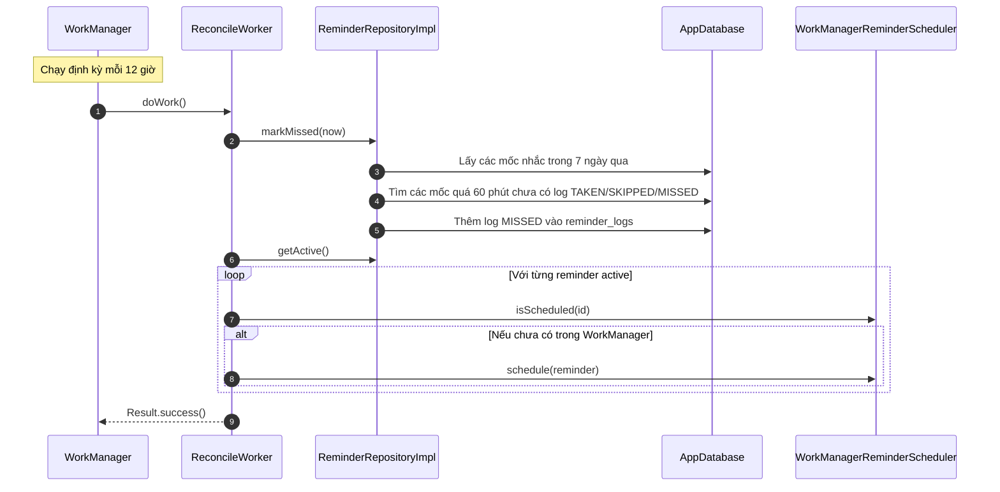

# 📱 TÀI LIỆU TOÀN DIỆN & REVIEW DỰ ÁN WORKMANAGER

> **Ứng Dụng Nhắc Nhở Lịch Uống Thuốc & Quản Lý Công Việc / Học Tập**  
> Tài liệu này mô tả chi tiết về kiến trúc hệ thống, cấu trúc cơ sở dữ liệu, các thuật toán cốt lõi, luồng xử lý tác vụ ngầm, hệ thống thông báo tương tác và hướng dẫn phát triển cho đội ngũ lập trình viên.

---

## 📋 MỤC LỤC
1. [Tổng Quan Dự Án](#1-tổng-quan-dự-án)
2. [Công Nghệ & Thư Viện Sử Dụng (Tech Stack)](#2-công-nghệ--thư-viện-sử-dụng-tech-stack)
3. [Kiến Trúc Hệ Thống (Architecture)](#3-kiến-trúc-hệ-thống-architecture)
4. [Cấu Trúc Thư Mục Dự Án (Project Structure)](#4-cấu-trúc-thư-mục-dự-án-project-structure)
5. [Chi Tiết Các Thành Phần Cốt Lõi (Core Technical Components)](#5-chi-tiết-các-thành-phần-cốt-lõi-core-technical-components)
   * 5.1 [Lớp Dữ Liệu & Room Database](#51-lớp-dữ-liệu--room-database)
   * 5.2 [Lớp Nghiệp Vụ & Thuật Toán Thời Gian](#52-lớp-nghiệp-vụ--thuật-toán-thời-gian)
   * 5.3 [Lập Lịch Ngầm & Tự Động Khôi Phục](#53-lập-lịch-ngầm--tự-động-khôi-phục)
   * 5.4 [Hệ Thống Thông Báo Tương Tác](#54-hệ-thống-thông-báo-tương-tác)
   * 5.5 [Xử Lý Sự Kiện Máy & BroadcastReceivers](#55-xử-lý-sự-kiện-máy--broadcastreceivers)
6. [Sơ Đồ Luồng Xử Lý Cốt Lõi (Sequence Diagrams)](#6-sơ-đồ-luồng-xử-lý-cốt-lõi-sequence-diagrams)
7. [Giao Diện & Quản Lý Trạng Thái (UI & State Management)](#7-giao-diện--quản-lý-trạng-thái-ui--state-management)
8. [Kiểm Thử Tự Động (Automated Testing)](#8-kiểm-thử-tự-động-automated-testing)
9. [Hướng Dẫn Onboarding & Quy Trình Phát Triển](#9-hướng-dẫn-onboarding--quy-trình-phát-triển)

---

## 1. TỔNG QUAN DỰ ÁN

**WorkManager** là ứng dụng Android được xây dựng hoàn toàn bằng Kotlin & Jetpack Compose, giúp người dùng lập lịch, theo dõi và duy trì thói quen cá nhân với 2 loại nhắc nhở chính:
* 💊 **Nhắc nhở Uống Thuốc (`MEDICINE`)**: Quản lý lịch uống theo ngày trong tuần, theo dõi số lượng thuốc còn lại trong hộp, tự động trừ số lượng khi người dùng xác nhận "Đã uống", phát cảnh báo khi kho thuốc sắp hết ($\le 3$ viên) và thống kê tỷ lệ tuân thủ.
* 📚 **Nhắc nhở Công Việc / Học Tập (`STUDY`)**: Lập lịch nhắc nhở lặp lại theo thứ trong tuần, hỗ trợ ngày bắt đầu và ngày kết thúc linh hoạt.

### 🌟 Điểm Nổi Bật Về Mặt Kỹ Thuật
* **Khả năng sinh tồn tác vụ ngầm (Reliable Background Execution)**: Phối hợp `WorkManager` với `BootReceiver` đảm bảo không bị mất lịch khi thiết bị khởi động lại, thay đổi múi giờ, cập nhật giờ hệ thống hoặc nâng cấp ứng dụng.
* **Tương tác trực tiếp qua Notification Actions**: Người dùng tương tác trực tiếp qua thông báo mà không cần mở app: **"Đã uống / Hoàn thành"** (`ACTION_TAKEN`), **"Hoãn 10 phút"** (`ACTION_SNOOZE`), **"Bỏ qua"** (`ACTION_SKIP`).
* **Đối soát tự động định kỳ 12h (`ReconcileWorker`)**: Quét và ghi nhận các lần nhắc bị bỏ lỡ (`MISSED`) nếu quá 60 phút người dùng không phản hồi, đồng thời kiểm tra và đặt lại các công việc bị hủy do hệ thống tối ưu bộ nhớ.
* **Xử lý bất đồng bộ & Dependency Injection chuẩn chỉnh**: Tích hợp Hilt với WorkManager (`HiltWorker`) và BroadcastReceiver (`EntryPointAccessors`).
* **Giao diện hiện đại & Mượt mà**: Jetpack Compose Material 3, hiệu ứng nền chuyển động `AmbientBackground`, hiệu ứng nạp dữ liệu `Shimmer`, vuốt để xóa (`SwipeToDismissBox`) kèm cơ chế hoàn tác (Undo).

---

## 2. CÔNG NGHỆ & THƯ VIỆN SỬ DỤNG (TECH STACK)

| Thành phần | Công nghệ / Library | Phiên bản / Mô tả |
| :--- | :--- | :--- |
| **Language** | Kotlin | `2.x` (Java 17 target compatibility) |
| **SDK Targets** | Compile SDK `37` / Target SDK `35` / Min SDK `26` | Tương thích từ Android 8.0 trở lên |
| **UI Framework** | Jetpack Compose + Material 3 | Declarative UI, Material Design 3 |
| **Navigation** | Navigation Compose | Điều hướng Single-Activity với chuyển cảnh hoạt hình |
| **Dependency Injection** | Hilt (Dagger Hilt) + Hilt Work | Quản lý phụ thuộc cho App, ViewModels, Receivers, Workers |
| **Local Database** | Room Database + KSP | Lưu trữ dữ liệu cục bộ với KSP Schema Export |
| **Background Scheduling** | AndroidX WorkManager + Hilt Work | Lập lịch chính xác & chạy tác vụ ngầm định kỳ |
| **Async & Data Stream** | Coroutines + Flow / StateFlow / Channel | Xử lý bất đồng bộ và luồng dữ liệu thời gian thực |
| **App Startup** | AndroidX Startup Runtime | Khởi tạo thành phần ứng dụng hiệu quả |
| **Notifications** | AndroidX Core NotificationCompat | Hiển thị thông báo ưu tiên, đa kênh (Channels), Action buttons |

---

## 3. KIẾN TRÚC HỆ THỐNG (ARCHITECTURE)

Dự án tuân thủ mô hình **MVVM (Model-View-ViewModel)** kết hợp nguyên lý **Clean Architecture**:



---

## 4. CẤU TRÚC THƯ MỤC DỰ ÁN (PROJECT STRUCTURE)

```
app/src/main/java/com/example/workmanager/
├── WorkManagerApp.kt             # Application class, cấu hình Configuration.Provider cho Hilt Work, tạo Notification Channels & lịch ReconcileWorker 12h
├── MainActivity.kt               # Activity duy nhất, xử lý yêu cầu quyền POST_NOTIFICATIONS, nạp NavGraph
├── data/                         # LỚP DỮ LIỆU (DATA LAYER)
│   ├── local/
│   │   ├── AppDatabase.kt        # Room Database (entities: ReminderEntity, ReminderLogEntity)
│   │   ├── Converters.kt         # TypeConverters cho Enum (LogStatus, ReminderType)
│   │   ├── ReminderDao.kt        # DAO quản lý bảng 'reminders'
│   │   ├── ReminderEntity.kt     # Entity chứa thông tin nhắc nhở & kho thuốc
│   │   ├── ReminderLogDao.kt     # DAO quản lý nhật ký 'reminder_logs'
│   │   ├── ReminderLogEntity.kt  # Entity ghi nhận từng lần nhắc (TAKEN, SKIPPED, MISSED, SNOOZED)
│   │   └── ReminderLogItem.kt   # Data class chứa kết quả JOIN log + tiêu đề nhắc nhở
│   └── repository/
│       ├── ReminderRepository.kt # Interface Repository định nghĩa các thao tác dữ liệu & nghiệp vụ
│       └── ReminderRepositoryImpl.kt # Implementation xử lý logic Room, trừ kho thuốc, tính toán markMissed
├── di/                           # DEPENDENCY INJECTION (HILT MODULES)
│   ├── AppModule.kt              # DatabaseModule & BindingModule (Repository, Scheduler)
│   └── ReceiverEntryPoint.kt     # Hilt EntryPoint cung cấp dependency cho BroadcastReceiver
├── domain/                       # LỚP NGHIỆP VỤ (DOMAIN LAYER)
│   ├── model/
│   │   ├── LogStatus.kt          # Enum: TAKEN, SKIPPED, MISSED, SNOOZED
│   │   ├── ReminderType.kt       # Enum: MEDICINE, STUDY
│   │   └── StockRules.kt         # Quy tắc kho thuốc (LOW_THRESHOLD = 3)
│   ├── scheduler/
│   │   ├── ReminderScheduler.kt  # Interface giao tiếp lập lịch
│   │   └── WorkManagerReminderScheduler.kt # Thực thi lập lịch bằng WorkManager (Unique Work)
│   └── util/
│       ├── LogStats.kt           # Thuật toán gộp log, tính toán thống kê tuần & tỷ lệ tuân thủ (%)
│       └── ReminderTimeUtils.kt  # Thuật toán tính trigger tiếp theo, bitmask ngày trong tuần, tính occurrences
├── notification/
│   └── NotificationHelper.kt     # Quản lý 3 Notification Channels & tạo thông báo nhắc nhở / cảnh báo kho
├── receiver/
│   ├── BootReceiver.kt           # Đặt lại toàn bộ lịch khi khởi động máy / đổi múi giờ / đổi giờ hệ thống / update app
│   └── ReminderActionReceiver.kt # Tiếp nhận hành động từ nút bấm Notification (Đã uống, Hoãn 10p, Bỏ qua)
├── worker/
│   ├── ReminderWorker.kt         # CoroutineWorker thực thi khi đến giờ hẹn
│   └── ReconcileWorker.kt        # CoroutineWorker đối soát tự động chạy mỗi 12h
└── ui/                           # LỚP GIAO DIỆN (UI LAYER - COMPOSE)
    ├── components/
    │   ├── AmbientBackground.kt  # Nền chuyển động dải màu mượt mà
    │   └── Shimmer.kt            # Skeleton Loading Effect
    ├── edit/                     # Màn hình Tạo / Chỉnh sửa nhắc nhở
    │   ├── ReminderEditScreen.kt
    │   └── ReminderEditViewModel.kt
    ├── history/                  # Màn hình Lịch sử & Thống kê tuân thủ
    │   ├── HistoryScreen.kt
    │   └── HistoryViewModel.kt
    ├── list/                     # Màn hình Danh sách chính & Chọn ngày
    │   ├── ReminderListScreen.kt
    │   └── ReminderListViewModel.kt
    ├── navigation/
    │   └── NavGraph.kt           # Định tuyến ứng dụng (AppNavGraph) với hiệu ứng chuyển trang slide
    ├── splash/
    │   └── SplashScreen.kt       # Màn hình Chào mừng hoạt họa
    └── theme/                    # Cấu hình Material3 (Color, Type, Theme)
```

Các file kiểm thử unit test:
```
app/src/test/java/com/example/workmanager/
└── domain/util/
    ├── LogStatsTest.kt           # Unit test cho thuật toán gộp log & tính % tuân thủ
    └── ReminderTimeUtilsTest.kt  # Unit test cho tính toán thời điểm trigger, bitmask & occurrences
```

---

## 5. CHI TIẾT CÁC THÀNH PHẦN CỐT LÕI (CORE TECHNICAL COMPONENTS)

### 5.1. Lớp Dữ Liệu & Room Database

#### Bảng `reminders` ([`ReminderEntity.kt`](file:///D:/HCMUTE/WorkManager/app/src/main/java/com/example/workmanager/data/local/ReminderEntity.kt))
Lưu trữ thông tin chi tiết về từng lịch nhắc nhở:

```kotlin
@Entity(tableName = "reminders")
data class ReminderEntity(
    @PrimaryKey(autoGenerate = true) val id: Long = 0,
    val title: String,
    val note: String = "",
    val type: ReminderType,            // MEDICINE hoặc STUDY
    val hour: Int,                      // 0..23
    val minute: Int,                    // 0..59
    val daysOfWeek: Int,                // Bitmask: bit0 = T2 ... bit6 = CN
    val startDate: Long,                // epochDay (LocalDate.toEpochDay())
    val endDate: Long? = null,          // epochDay (null = không hết hạn)
    val dosage: String? = null,         // VD: "1 viên sau ăn"
    val remainingQty: Int? = null,      // Số lượng thuốc còn lại trong kho
    val isActive: Boolean = true,       // Trạng thái bật/tắt
    val createdAt: Long = System.currentTimeMillis()
)
```

#### Bảng `reminder_logs` ([`ReminderLogEntity.kt`](file:///D:/HCMUTE/WorkManager/app/src/main/java/com/example/workmanager/data/local/ReminderLogEntity.kt))
Ghi nhận nhật ký tương tác cho từng lần nhắc. Có thiết lập khóa ngoại liên kết với `reminders` với chính sách xóa dây chuyền (`CASCADE`):

```kotlin
@Entity(
    tableName = "reminder_logs",
    foreignKeys = [
        ForeignKey(
            entity = ReminderEntity::class,
            parentColumns = ["id"],
            childColumns = ["reminderId"],
            onDelete = ForeignKey.CASCADE
        )
    ],
    indices = [Index("reminderId")]
)
data class ReminderLogEntity(
    @PrimaryKey(autoGenerate = true) val id: Long = 0,
    val reminderId: Long,
    val scheduledTime: Long,            // epochMillis thời điểm dự kiến
    val status: LogStatus,              // TAKEN, SKIPPED, MISSED, SNOOZED
    val actedAt: Long? = null           // epochMillis thời điểm tương tác
)
```

#### Thao tác DAO quan trọng ([`ReminderDao.kt`](file:///D:/HCMUTE/WorkManager/app/src/main/java/com/example/workmanager/data/local/ReminderDao.kt) & [`ReminderLogDao.kt`](file:///D:/HCMUTE/WorkManager/app/src/main/java/com/example/workmanager/data/local/ReminderLogDao.kt))
* `@Insert(onConflict = OnConflictStrategy.REPLACE)` trong `ReminderDao`: Giúp tính năng **Hoàn tác xóa (Undo Delete)** chèn lại chính xác bản ghi cũ với đúng `id` ban đầu mà không làm hỏng liên kết log.
* `observeAllWithReminder()` trong `ReminderLogDao`: Truy vấn INNER JOIN ghép `reminder_logs` với `reminders` để lấy tiêu đề nhắc nhở hiển thị ở màn hình Lịch sử.

---

### 5.2. Lớp Nghiệp Vụ & Thuật Toán Thời Gian

#### Thuật Toán Lên Lịch & Bitmask ([`ReminderTimeUtils.kt`](file:///D:/HCMUTE/WorkManager/app/src/main/java/com/example/workmanager/domain/util/ReminderTimeUtils.kt))
* **Mã hóa các ngày trong tuần bằng Bitmask**:
  * Bit 0 (giá trị 1): Thứ Hai (`DayOfWeek.MONDAY`)
  * Bit 1 (giá trị 2): Thứ Ba (`DayOfWeek.TUESDAY`)
  * ...
  * Bit 6 (giá trị 64): Chủ Nhật (`DayOfWeek.SUNDAY`)
* **Hàm `computeNextTrigger(reminder, now)`**:
  1. Nếu `daysOfWeek == 0`, trả về `null` (không lên lịch).
  2. Xác định ngày bắt đầu tìm kiếm: `max(startDate, today)`.
  3. Duyệt tối đa 8 ngày tiếp theo để tìm mốc thời gian thỏa mãn bitmask và thời gian `(hour, minute)` lớn hơn mốc `now`.
  4. Nếu vượt quá `endDate`, trả về `null`.
* **Hàm `occurrencesBetween(reminder, fromExclusive, toInclusive)`**:
  Trả về danh sách tất cả các mốc giờ nhắc trong khoảng `(fromExclusive, toInclusive]` để phục vụ việc kiểm tra bỏ lỡ (`markMissed`).

#### Thuật Toán Gộp Log & Thống Kê Tuần ([`LogStats.kt`](file:///D:/HCMUTE/WorkManager/app/src/main/java/com/example/workmanager/domain/util/LogStats.kt))
* Một mốc thời gian nhắc có thể sinh ra nhiều log (VD: `SNOOZED` rồi mới `TAKEN`).
* **Hàm `finalLogs`**: Nhóm theo cặp `(reminderId, scheduledTime)` và chọn ra trạng thái có độ ưu tiên cao nhất:  
  $$\text{TAKEN (3)} > \text{SKIPPED (2)} > \text{MISSED (1)} > \text{SNOOZED (0)}$$
* **Hàm `weekly`**: Tính thống kê 7 ngày gần nhất tính đến hôm nay. Bỏ qua các log có trạng thái duy nhất là `SNOOZED` khi tính tỷ lệ tuân thủ:
  $$\text{Rate (\%)} = \frac{\text{TAKEN}}{\text{TAKEN} + \text{SKIPPED} + \text{MISSED}} \times 100$$

---

### 5.3. Lập Lịch Ngầm & Tự Động Khôi Phục

#### `WorkManagerReminderScheduler` ([`WorkManagerReminderScheduler.kt`](file:///D:/HCMUTE/WorkManager/app/src/main/java/com/example/workmanager/domain/scheduler/WorkManagerReminderScheduler.kt))
* Lên lịch cho mỗi nhắc nhở thông qua `OneTimeWorkRequestBuilder<ReminderWorker>()`.
* Tên Unique Work chính: `reminder_{id}` với chính sách `ExistingWorkPolicy.REPLACE`.
* Tên Unique Work hoãn (`snooze`): `snooze_{id}` chạy độc lập, không làm ngắt chuỗi lịch chính.

#### `ReminderWorker` ([`ReminderWorker.kt`](file:///D:/HCMUTE/WorkManager/app/src/main/java/com/example/workmanager/worker/ReminderWorker.kt))
* Được khởi tạo thông qua `@HiltWorker` + `@AssistedInject`.
* Kiểm tra nhắc nhở có tồn tại và đang active hay không. Nếu có, phát thông báo qua `NotificationHelper.show()`.
* Ngoại trừ trường hợp hoãn (`isSnooze == true`), Worker sẽ tự động gọi `scheduler.scheduleNext()` để nối chuỗi lần nhắc kế tiếp.

#### `ReconcileWorker` ([`ReconcileWorker.kt`](file:///D:/HCMUTE/WorkManager/app/src/main/java/com/example/workmanager/worker/ReconcileWorker.kt))
* Được lên lịch chạy định kỳ 12h/lần từ [`WorkManagerApp.kt`](file:///D:/HCMUTE/WorkManager/app/src/main/java/com/example/workmanager/WorkManagerApp.kt) với `ExistingPeriodicWorkPolicy.UPDATE` và `BackoffPolicy.LINEAR` 30s.
* Tự động quét các mốc giờ nhắc đã qua vượt quá khoảng thời gian gia hạn (**`MISSED_GRACE_MS = 60 phút`**) trong vòng 7 ngày qua (**`LOOKBACK_MS = 7 ngày`**) và tự động ghi log `MISSED`.
* Kiểm tra tất cả nhắc nhở active: nếu còn lần nhắc tiếp theo nhưng chưa có trong queue WorkManager (`!isScheduled`), Worker sẽ tự động khôi phục lịch.

---

### 5.4. Hệ Thống Thông Báo Tương Tác

#### `NotificationHelper` ([`NotificationHelper.kt`](file:///D:/HCMUTE/WorkManager/app/src/main/java/com/example/workmanager/notification/NotificationHelper.kt))
Khởi tạo 3 Notification Channels chính:
1. `medicine_reminders` (`CHANNEL_MEDICINE`): `IMPORTANCE_HIGH`, có bật rung, danh mục `CATEGORY_REMINDER`.
2. `study_reminders` (`CHANNEL_STUDY`): `IMPORTANCE_DEFAULT`.
3. `stock_alerts` (`CHANNEL_STOCK`): `IMPORTANCE_DEFAULT` cho cảnh báo kho thuốc sắp hết hoặc đã hết.

Tạo các Action Buttons có `requestCode` riêng biệt `(reminder.id * 10 + slot)` để tránh bị đè intent:
* **"Đã uống" / "Hoàn thành"**: Phát broadcast `ACTION_TAKEN`.
* **"Hoãn 10 phút"**: Phát broadcast `ACTION_SNOOZE`.
* **"Bỏ qua"**: Phát broadcast `ACTION_SKIP`.

Cảnh báo kho thuốc sắp hết (`showLowStock`): Khi số lượng thuốc $\le 3$ viên (`StockRules.LOW_THRESHOLD`), hiển thị thông báo nhắc nhở người dùng bổ sung thêm thuốc.

---

### 5.5. Xử Lý Sự Kiện Máy & BroadcastReceivers

#### `BootReceiver` ([`BootReceiver.kt`](file:///D:/HCMUTE/WorkManager/app/src/main/java/com/example/workmanager/receiver/BootReceiver.kt))
* Đăng ký lắng nghe các sự kiện hệ thống: `ACTION_BOOT_COMPLETED`, `ACTION_TIMEZONE_CHANGED`, `ACTION_TIME_CHANGED`, `ACTION_MY_PACKAGE_REPLACED`.
* Sử dụng `goAsync()` để mở rộng thời gian sống của receiver, truy xuất Repository qua [`ReceiverEntryPoint`](file:///D:/HCMUTE/WorkManager/app/src/main/java/com/example/workmanager/di/ReceiverEntryPoint.kt) (`EntryPointAccessors.fromApplication`) và đặt lại toàn bộ các lịch active.

#### `ReminderActionReceiver` ([`ReminderActionReceiver.kt`](file:///D:/HCMUTE/WorkManager/app/src/main/java/com/example/workmanager/receiver/ReminderActionReceiver.kt))
* Tiếp nhận và xử lý sự kiện khi người dùng nhấn nút trên thông báo.
* Hủy notification tương ứng qua `NotificationManagerCompat.cancel(reminderId)`.
* Với `ACTION_TAKEN`: Nếu là thuốc và còn số lượng, tự động trừ 1 đơn vị. Nếu số lượng sau khi trừ $\le 3$, kích hoạt thông báo cảnh báo kho.
* Với `ACTION_SNOOZE`: Ghi log `SNOOZED` và gọi `scheduler.snooze(reminder, scheduledTime, 10_MINUTES)`.

---

## 6. SƠ ĐỒ LUỒNG XỬ LÝ CỐT LÕI (SEQUENCE DIAGRAMS)

### 6.1. Luồng Lên Lịch & Hiển Thị Thông Báo Nhắc Nhở


### 6.2. Luồng Phản Hồi Từ Thông Báo & Khấu Trừ Kho Thuốc


### 6.3. Luồng Tự Động Đối Soát & Khôi Phục Lịch (12h Reconcile)


---

## 7. GIAO DIỆN & QUẢN LÝ TRẠNG THÁI (UI & STATE MANAGEMENT)

### 7.1. Các Màn Hình Chính
1. **[`SplashScreen.kt`](file:///D:/HCMUTE/WorkManager/app/src/main/java/com/example/workmanager/ui/splash/SplashScreen.kt)**:
   - Màn hình chào với logo hoạt hình nảy nhẹ & mờ dần, điều hướng tự động sang danh sách nhắc nhở.
2. **[`ReminderListScreen.kt`](file:///D:/HCMUTE/WorkManager/app/src/main/java/com/example/workmanager/ui/list/ReminderListScreen.kt)**:
   - **Thanh chọn ngày ngang (Horizontal Date Selector)**: Cho phép chuyển ngày linh hoạt trong tuần và lọc danh sách nhắc nhở tương ứng.
   - **Thẻ Nhắc Nhở Accent**: Màu nền pastel phân biệt theo ID, hiển thị trạng thái công việc / liều lượng thuốc.
   - **Thanh Tiến Trình Kho Thuốc (`StockProgressBar`)**: Tự điều chỉnh thang đo linh hoạt theo lượng nhập ban đầu và tự động chuyển màu cảnh báo đỏ khi còn $\le 3$ viên.
   - **Xóa dạng vuốt (`SwipeToDismissBox`)**: Hỗ trợ vuốt sang trái/phải để xóa thẻ kèm Snackbar Hoàn tác (Undo).
   - **Dialog Hướng Dẫn Tối Ưu Pin**: Cung cấp lối tắt mở Cài đặt ứng dụng để người dùng tắt tính năng Tối ưu hóa pin của hệ thống.
3. **[`ReminderEditScreen.kt`](file:///D:/HCMUTE/WorkManager/app/src/main/java/com/example/workmanager/ui/edit/ReminderEditScreen.kt)**:
   - Cho phép tạo mới hoặc chỉnh sửa nhắc nhở.
   - Bắt lỗi dữ liệu đầu vào (tiêu đề trống, chưa chọn ngày, ngày kết thúc trước ngày bắt đầu, số lượng thuốc âm).
   - Chọn giờ bằng `TimePickerDialog`, chọn các ngày trong tuần dạng Chip toggle.
4. **[`HistoryScreen.kt`](file:///D:/HCMUTE/WorkManager/app/src/main/java/com/example/workmanager/ui/history/HistoryScreen.kt)**:
   - **Card Thống Kê Tuần (`WeeklyCard`)**: Biểu đồ cột trực quan hóa số lần Uống/Hoàn thành (`TAKEN`) so với Bỏ qua/Quá hạn (`SKIPPED`/`MISSED`), hiển thị tỷ lệ tuân thủ %.
   - **Danh sách Nhật ký Chi tiết**: Hiển thị ngày giờ, tên nhắc nhở và Badge trạng thái tương ứng.

### 7.2. Thành Phần Giao Diện Tùy Chỉnh (Custom Components)
* **[`AmbientBackground.kt`](file:///D:/HCMUTE/WorkManager/app/src/main/java/com/example/workmanager/ui/components/AmbientBackground.kt)**: Nền Canvas sử dụng `Brush.radialGradient` biến đổi tọa độ mượt mà theo thời gian.
* **[`Shimmer.kt`](file:///D:/HCMUTE/WorkManager/app/src/main/java/com/example/workmanager/ui/components/Shimmer.kt)**: Hiệu ứng Skeleton loading hiển thị mượt mà trong khi chờ dữ liệu tải từ Room Database.

### 7.3. Định Tuyến & Chuyển Cảnh ([`NavGraph.kt`](file:///D:/HCMUTE/WorkManager/app/src/main/java/com/example/workmanager/ui/navigation/NavGraph.kt))
* Sử dụng `Navigation Compose` với các Route: `splash`, `list`, `history`, `edit?reminderId={reminderId}`.
* Cấu hình hiệu ứng chuyển trang `slideIntoContainer` & `slideOutOfContainer` kết hợp `fadeIn` / `fadeOut` cho trải nghiệm chuyển cảnh mượt mà.

---

## 8. KIỂM THỬ TỰ ĐỘNG (AUTOMATED TESTING)

Dự án chú trọng kiểm thử đơn vị (Unit Test) cho các hàm xử lý thuật toán thời gian và thống kê tại thư mục `app/src/test/`:

1. **[`ReminderTimeUtilsTest.kt`](file:///D:/HCMUTE/WorkManager/app/src/test/java/com/example/workmanager/domain/util/ReminderTimeUtilsTest.kt)**:
   - Testing tính toán mốc trigger cùng ngày (chưa qua giờ và đã qua giờ).
   - Testing bỏ qua các ngày không được chọn trong bitmask.
   - Testing mốc giờ lặp lại tuần tiếp theo.
   - Testing vượt mốc ngày kết thúc (`endDate`) trả về `null`.
   - Testing mã hóa và giải mã bitmask 7 ngày trong tuần.
   - Testing thuật toán `occurrencesBetween` trong khoảng từ ngày A đến ngày B.

2. **[`LogStatsTest.kt`](file:///D:/HCMUTE/WorkManager/app/src/test/java/com/example/workmanager/domain/util/LogStatsTest.kt)**:
   - Testing thứ tự ưu tiên gộp log (`TAKEN` thắng `MISSED`/`SKIPPED` trên cùng một mốc giờ).
   - Testing bỏ qua log `SNOOZED` khi tính tỷ lệ tuân thủ %.
   - Testing tính toán chính xác số lượng `TAKEN`, `SKIPPED`, `MISSED` và phần trăm tuân thủ tuần.
   - Testing chỉ lấy dữ liệu trong cửa sổ 7 ngày gần nhất.

---

## 9. HƯỚNG DẪN ONBOARDING & QUY TRÌNH PHÁT TRIỂN

### 9.1. Yêu Cầu Môi Trường Phát Triển
* **Android Studio**: Ladybug (2024.2) hoặc phiên bản mới hơn.
* **JDK**: Java 17.
* **Gradle Build Tool**: `8.x` tích hợp **KSP (Kotlin Symbol Processing)** Plugin.

### 9.2. Các Bước Khởi Chạy Ứng Dụng
1. Clone repository về máy tính.
2. Mở dự án bằng Android Studio và chờ hoàn tất quá trình Gradle Sync.
3. Chạy kiểm thử tự động để xác nhận logic:
   ```bash
   ./gradlew test
   ```
4. Biên dịch và cài đặt lên thiết bị / Emulator (Android 8.0 trở lên):
   ```bash
   ./gradlew assembleDebug
   ```

### 9.3. Quy Trình Cập Nhật Cơ Sở Dữ Liệu (Room Migration)
* KSP được cấu hình tự động xuất Schema ra thư mục `app/schemas` thông qua thiết lập:
  ```kotlin
  ksp {
      arg("room.schemaLocation", "$projectDir/schemas")
  }
  ```
* Khi thay đổi cấu trúc bảng trong [`ReminderEntity.kt`](file:///D:/HCMUTE/WorkManager/app/src/main/java/com/example/workmanager/data/local/ReminderEntity.kt) hoặc [`ReminderLogEntity.kt`](file:///D:/HCMUTE/WorkManager/app/src/main/java/com/example/workmanager/data/local/ReminderLogEntity.kt):
  1. Tăng `version` trong [`AppDatabase.kt`](file:///D:/HCMUTE/WorkManager/app/src/main/java/com/example/workmanager/data/local/AppDatabase.kt).
  2. Viết Migration tương ứng trong Database Builder hoặc cấu hình `fallbackToDestructiveMigration()` nếu trong giai đoạn phát triển thử nghiệm.

### 9.4. Lưu Ý Quan Trọng Khi Lập Trình Trên Android Dòng Máy Tùy Biến (Custom ROMs)
* **Quyền Thông Báo (`POST_NOTIFICATIONS`)**: Ứng dụng đã tích hợp launcher xin quyền tự động tại [`MainActivity.kt`](file:///D:/HCMUTE/WorkManager/app/src/main/java/com/example/workmanager/MainActivity.kt) đối với Android 13 (API 33)+.
* **Cơ chế diệt tác vụ ngầm gắt gao (Xiaomi HyperOS/MIUI, Samsung OneUI, OPPO ColorOS)**: Các nhà sản xuất thiết bị thường có cơ chế diệt ứng dụng chạy ngầm dội ra. Lập trình viên nên kiểm tra và hướng dẫn người dùng bật tùy chọn **"Tự khởi chạy (Autostart)"** và chọn **"Không hạn chế pin (No restrictions)"** trong Cài đặt hệ thống để đảm bảo `WorkManager` và `BootReceiver` hoạt động ổn định nhất.

---
*Tài liệu được cập nhật chuẩn xác theo toàn bộ mã nguồn dự án WorkManager.*

---

## 10. HẠN CHẾ ĐÃ BIẾT & HƯỚNG PHÁT TRIỂN

* **Độ chính xác giờ nhắc**: nhắc nhở dùng `OneTimeWork` + `setInitialDelay` nên không chính xác tuyệt đối; Doze/tiết kiệm pin có thể làm trễ vài phút (đã log `lateMs` trong `ReminderWorker`). Hướng nâng cấp: dùng `AlarmManager.setExactAndAllowWhileIdle` cho nhắc thuốc.
* **Chuỗi nhắc không bị đứt**: `ReminderWorker` đặt lần kế tiếp *trước* khi hiện thông báo; `ReconcileWorker` (12h) tự phục hồi lịch bị hệ thống/OEM huỷ.
* **Quyền thông báo**: nếu bị từ chối, app hiện hộp thoại dẫn tới Cài đặt thông báo.
* **Chưa có**: test instrumented cho Worker/Room (đã có sẵn `work-testing`), nhiều mốc giờ trong một nhắc nhở, hướng dẫn tắt tối ưu pin cho ROM tuỳ biến.
