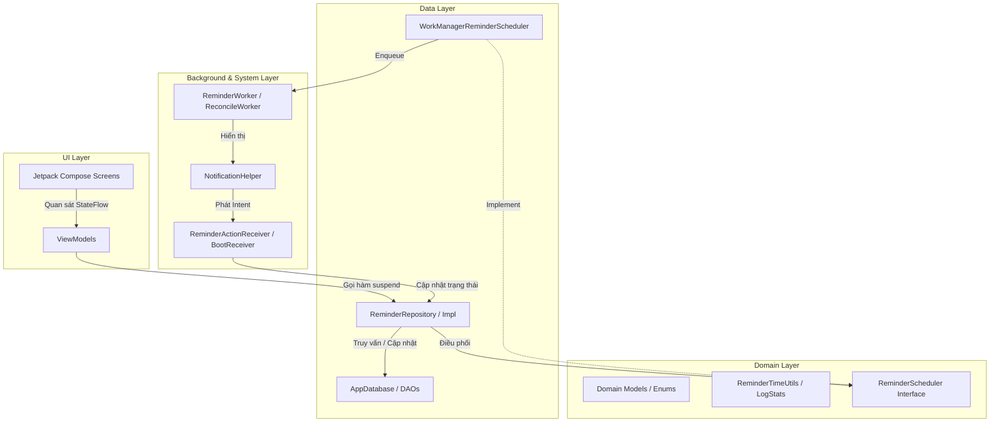
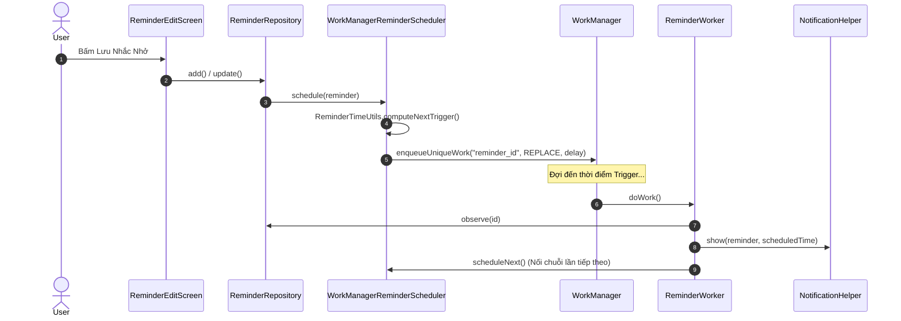
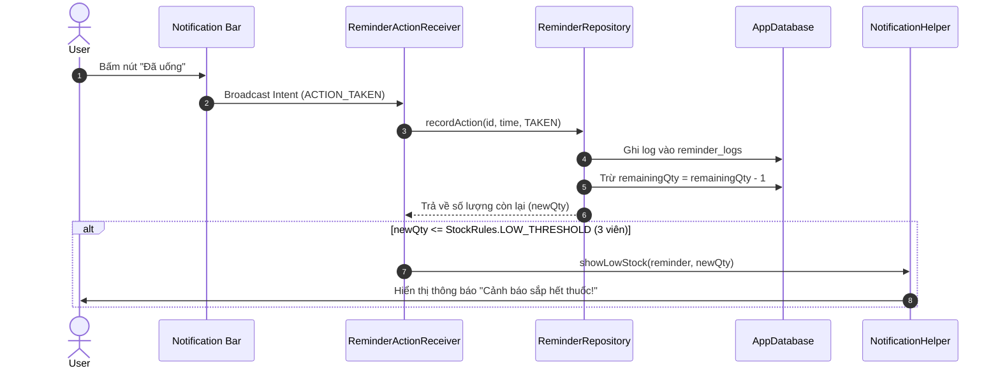

# 📱 TÀI LIỆU REVIEW & TỔNG QUAN DỰ ÁN WORKMANAGER

> **Ứng Dụng Nhắc Nhở Lịch Uống Thuốc & Công Việc/Học Tập**  
> Tài liệu này cung cấp cái nhìn toàn diện về kiến trúc, các luồng xử lý cốt lõi, công nghệ sử dụng và hướng dẫn phát triển cho các thành viên trong đội ngũ lập trình.

---

## 📋 MỤC LỤC
1. [Tổng Quan Dự Án](#1-tổng-quan-dự-án)
2. [Công Nghệ Sử Dụng (Tech Stack)](#2-công-nghệ-sử-dụng-tech-stack)
3. [Kiến Trúc Hệ Thống (Architecture)](#3-kiến-trúc-hệ-thống-architecture)
4. [Cấu Trúc Thư Mục (Project Structure)](#4-cấu-trúc-thư-mục-project-structure)
5. [Các Thành Phần Cốt Lõi (Core Components)](#5-các-thành-phần-cốt-lõi-core-components)
6. [Luồng Xử Lý Quan Trọng (Key Workflows)](#6-luồng-xử-lý-quan-trọng-key-workflows)
7. [Giao Diện & Trải Nghiệm Người Dùng (UI/UX)](#7-giao-diện--trải-nghiệm-người-dùng-uiux)
8. [Hướng Dẫn Dành Cho Developer Mới (Onboarding Guide)](#8-hướng-dẫn-dành-cho-developer-mới-onboarding-guide)

---

## 1. TỔNG QUAN DỰ ÁN

**WorkManager** là ứng dụng Android hiện đại hỗ trợ người dùng theo dõi và quản lý lịch trình cá nhân với hai mục đích chính:
* **Nhắc nhở Uống Thuốc (MEDICINE)**: Theo dõi liều lượng, số lượng thuốc còn lại trong kho, đưa ra cảnh báo khi thuốc sắp hết và ghi nhận nhật ký tuân thủ (Uống, Bỏ qua, Hoãn).
* **Nhắc nhở Công Việc / Học Tập (STUDY)**: Đặt lịch nhắc nhở học tập, làm việc lặp lại theo các ngày trong tuần.

### 🌟 Điểm nổi bật
* **Lập lịch chạy ngầm tin cậy**: Sử dụng **WorkManager** phối hợp với `BootReceiver` đảm bảo không mất lịch kể cả khi khởi động lại thiết bị, đổi múi giờ hoặc cập nhật ứng dụng.
* **Tương tác nhanh qua Thông báo**: Người dùng có thể bấm trực tiếp các nút **"Đã uống / Hoàn thành"**, **"Hoãn 10 phút"**, hoặc **"Bỏ qua"** ngay trên thanh thông báo.
* **Tự động đối soát (Reconciliation)**: Chạy định kỳ 24h để đánh dấu các lần nhắc nhở quá hạn không được phản hồi thành `MISSED` và khôi phục các lịch bị gián đoạn.
* **Thống kê & Biểu đồ tuân thủ**: Tính toán tỉ lệ tuân thủ hàng tuần, trực quan hóa bằng biểu đồ cột.
* **Giao diện hiện đại**: Thiết kế Jetpack Compose Material 3 với hiệu ứng nền chuyển động Ambient Background, Shimmer Loading Skeleton, Swipe-to-Delete với Hoàn tác (Undo).

---

## 2. CÔNG NGHỆ SỬ DỤNG (TECH STACK)

| Thành phần | Công nghệ / Library | Vai trò |
| :--- | :--- | :--- |
| **Language** | Kotlin 2.x | Ngôn ngữ phát triển chính |
| **Min / Target SDK** | SDK 26 (Android 8.0) / SDK 35 (Android 15) | Phạm vi tương thích thiết bị |
| **UI Framework** | Jetpack Compose + Material 3 | Giao diện khai báo (Declarative UI) |
| **Navigation** | Navigation Compose | Điều hướng giữa các màn hình |
| **Dependency Injection** | Hilt (Dagger Hilt) | Quản lý phụ thuộc (DI) cho App, ViewModels, Receivers, Workers |
| **Database** | Room Database + KSP | Lưu trữ cục bộ dữ liệu Reminders & Logs |
| **Background Scheduling** | AndroidX WorkManager + Hilt Work | Quản lý tác vụ ngầm & lập lịch chính xác |
| **Async & Reactive** | Kotlin Coroutines + Flow / StateFlow | Bất đồng bộ và quản lý luồng dữ liệu thời gian thực |
| **Notifications** | AndroidX Core NotificationCompat | Hiển thị thông báo tương tác & quản lý kênh thông báo (Channels) |

---

## 3. KIẾN TRÚC HỆ THỐNG (ARCHITECTURE)

Dự án áp dụng mô hình **MVVM (Model-View-ViewModel)** kết hợp nguyên lý **Clean Architecture**:



---

## 4. CẤU TRÚC THƯ MỤC (PROJECT STRUCTURE)

```
app/src/main/java/com/example/workmanager/
├── WorkManagerApp.kt             # Application class, khởi tạo Hilt & lịch ReconcileWorker 24h
├── MainActivity.kt               # Single Activity, xin quyền POST_NOTIFICATIONS, nạp NavGraph
├── data/                         # LỚP DỮ LIỆU (DATA LAYER)
│   ├── local/
│   │   ├── AppDatabase.kt        # Room Database (entities: ReminderEntity, ReminderLogEntity)
│   │   ├── Converters.kt         # TypeConverters cho Enum
│   │   ├── ReminderDao.kt        # DAO quản lý thông tin nhắc nhở
│   │   ├── ReminderEntity.kt     # Bảng 'reminders'
│   │   ├── ReminderLogDao.kt     # DAO quản lý nhật ký tương tác
│   │   ├── ReminderLogEntity.kt  # Bảng 'reminder_logs'
│   │   └── ReminderLogItem.kt   # Data class kết quả JOIN log + reminder title
│   └── repository/
│       ├── ReminderRepository.kt # Interface Repository
│       └── ReminderRepositoryImpl.kt # Implementation xử lý logic dữ liệu, trừ kho thuốc, đánh dấu MISSED
├── di/                           # DEPENDENCY INJECTION (HILT)
│   ├── AppModule.kt              # DatabaseModule & BindingModule
│   └── ReceiverEntryPoint.kt     # Hilt EntryPoint truy cập dependency từ BroadcastReceiver
├── domain/                       # LỚP NGHIỆP VỤ (DOMAIN LAYER)
│   ├── model/
│   │   ├── LogStatus.kt          # Enum: TAKEN, SKIPPED, MISSED, SNOOZED
│   │   ├── ReminderType.kt       # Enum: MEDICINE, STUDY
│   │   └── StockRules.kt         # Ngưỡng cảnh báo hết thuốc (LOW_THRESHOLD = 3)
│   ├── scheduler/
│   │   ├── ReminderScheduler.kt  # Interface lập lịch
│   │   └── WorkManagerReminderScheduler.kt # Lập lịch bằng WorkManager
│   └── util/
│       ├── LogStats.kt           # Tính toán thống kê tuần & tỉ lệ tuân thủ (%)
│       └── ReminderTimeUtils.kt  # Tính toán thời điểm nhắc tiếp theo, bitmask ngày
├── notification/
│   └── NotificationHelper.kt     # Tạo Channels (Thứ yếu, Ưu tiên, Cảnh báo kho) & build Notification
├── receiver/
│   ├── BootReceiver.kt           # Đặt lại lịch khi khởi động lại máy / đổi giờ / nâng cấp app
│   └── ReminderActionReceiver.kt # Tiếp nhận nút bấm action từ Notification (Đã uống, Hoãn, Bỏ qua)
├── worker/
│   ├── ReminderWorker.kt         # Worker thực thi khi đến giờ nhắc nhở
│   └── ReconcileWorker.kt        # Worker đối soát định kỳ 24h
└── ui/                           # LỚP GIAO DIỆN (UI LAYER - COMPOSE)
    ├── components/
    │   ├── AmbientBackground.kt  # Nền dải màu chuyển động radial gradient
    │   └── Shimmer.kt            # Skeleton Loading Effect
    ├── edit/                     # Màn hình Tạo / Sửa nhắc nhở
    │   ├── ReminderEditScreen.kt
    │   └── ReminderEditViewModel.kt
    ├── history/                  # Màn hình Lịch sử & Thống kê tuần
    │   ├── HistoryScreen.kt
    │   └── HistoryViewModel.kt
    ├── list/                     # Màn hình Danh sách nhắc nhở chính
    │   ├── ReminderListScreen.kt
    │   └── ReminderListViewModel.kt
    ├── navigation/
    │   └── NavGraph.kt           # Định tuyến ứng dụng với hiệu ứng chuyển trang
    ├── splash/
    │   └── SplashScreen.kt       # Màn hình chào với logo hoạt họa
    └── theme/                    # Cấu hình Material3 (Color, Type, Theme)
```

---

## 5. CÁC THÀNH PHẦN CỐT LÕI (CORE COMPONENTS)

### 5.1. Data Model (`ReminderEntity`)
Lưu giữ thông tin nhắc nhở:
- `daysOfWeek`: Bitmask 7 bit đại diện cho các ngày trong tuần (Bit 0 = Thứ 2 ... Bit 6 = Chủ nhật).
- `type`: `MEDICINE` (Thuốc) hoặc `STUDY` (Công việc/Học tập).
- `dosage`: Liều lượng sử dụng (VD: "1 viên sau ăn").
- `remainingQty`: Số lượng thuốc còn lại trong hộp (null nếu là công việc).

### 5.2. Background Scheduler (`WorkManagerReminderScheduler`)
- Quản lý việc lập lịch cho từng `ReminderEntity` thông qua `OneTimeWorkRequestBuilder<ReminderWorker>()`.
- Sử dụng `enqueueUniqueWork` với tên duy nhất `reminder_{id}` để tránh bị lặp lịch.
- Hỗ trợ cơ chế hoãn nhắc nhở (`snooze`) chạy song song với chuỗi lịch chính.

### 5.3. Notification System (`NotificationHelper`)
Tạo và quản lý 3 Notification Channels:
1. `medicine_reminders` (Importance HIGH): Có rung, hiển thị ưu tiên cho thuốc.
2. `study_reminders` (Importance DEFAULT): Cho lịch học tập / công việc.
3. `stock_alerts` (Importance DEFAULT): Cho cảnh báo kho thuốc sắp hết.

Tích hợp 3 Action Buttons ngay trên notification:
- **Đã uống / Hoàn thành** (`ACTION_TAKEN`)
- **Hoãn 10 phút** (`ACTION_SNOOZE`)
- **Bỏ qua** (`ACTION_SKIP`)

### 5.4. Broadcast Receivers
- **`ReminderActionReceiver`**: Chạy bất đồng bộ (`goAsync()`) xử lý tương tác từ thông báo. Nếu chọn `TAKEN` và là nhắc nhở thuốc, tự động trừ 1 số lượng thuốc và hiển thị thông báo cảnh báo kho nếu số lượng còn lại $\le 3$.
- **`BootReceiver`**: Đăng ký các action `BOOT_COMPLETED`, `TIMEZONE_CHANGED`, `TIME_SET`, `MY_PACKAGE_REPLACED`. Khi kích hoạt, tự động tải danh sách nhắc nhở đang bật và tính toán lại lịch ngầm.

### 5.5. Reconcile Worker (`ReconcileWorker`)
- Khởi chạy định kỳ 24h 1 lần thông qua `WorkManager.enqueueUniquePeriodicWork`.
- Gọi `repository.markMissed(now)` để tìm các thời điểm nhắc nhở trong quá khứ không được phản hồi (vượt quá 60 phút grace period) và ghi log `MISSED`.
- Khôi phục lại các tác vụ ngầm bị hủy do hệ thống dọn dẹp bộ nhớ.

---

## 6. LUỒNG XỬ LÝ QUAN TRỌNG (KEY WORKFLOWS)

### 6.1. Luồng Lên Lịch & Hiển Thị Thông Báo


### 6.2. Luồng Phản Hồi Từ Thông Báo & Trừ Hàng Tồn Kho


---

## 7. GIAO DIỆN & TRẢI NGHIỆM NGƯỜI DÙNG (UI/UX)

1. **Màn Hình Splash (`SplashScreen`)**:
   - Hoạt họa logo scale & fade-in mượt mà, sẵn sàng chuyển vào danh sách.
2. **Màn Hình Danh Sách (`ReminderListScreen`)**:
   - **Thanh chọn ngày ngang (Horizontal Date Selector)**: Cho phép chuyển đổi nhanh giữa các ngày trong tuần và tự động lọc các lời nhắc tương ứng.
   - **Thẻ Nhắc Nhở Pastel Accent**: Màu sắc nhẹ nhàng, đổi màu theo ID và trạng thái bật/tắt.
   - **Thanh tiến trình thuốc linh hoạt (`StockProgressBar`)**: Tự điều chỉnh thang đo phù hợp với số lượng nhập (10, 30, 50, 100...) và chuyển màu đỏ cảnh báo khi còn $\le 3$ viên.
   - **Thao tác Swipe-to-Delete**: Vuốt để xóa thẻ kèm Snackbar Hoàn tác (Undo).
   - **Hướng dẫn tối ưu Pin**: Dialog hỗ trợ người dùng mở cài đặt Tắt tối ưu hóa pin để không bị diệt tác vụ ngầm.
3. **Màn Hình Lịch Sử & Thống Kê (`HistoryScreen`)**:
   - **Card Thống kê tuần (`WeeklyCard`)**: Biểu đồ cột trực quan phân định số lần Uống (`TAKEN`) và Không uống (`MISSED`/`SKIPPED`), hiển thị % tuân thủ.
   - **Danh sách nhật ký**: Từng dòng log hiển thị rõ thời gian, tên lời nhắc và badge trạng thái sinh động.
4. **Hiệu ứng thị giác**:
   - **AmbientBackground**: Tạo cảm giác hiện đại với dải màu chuyển động chậm.
   - **Shimmer Effect**: Skeleton loading trong lúc nạp dữ liệu từ Room DB.

---

## 8. HƯỚNG DẪN DÀNH CHO DEVELOPER MỚI (ONBOARDING GUIDE)

### 8.1. Yêu Cầu Môi Trường
- **Android Studio**: Ladybug (2024.2) hoặc mới hơn.
- **JDK**: Java 17.
- **Gradle**: 8.x + KSP Plugin.

### 8.2. Các Bước Khởi Chạy Project
1. Clone dự án về máy.
2. Mở dự án trong Android Studio và đợi Gradle Sync hoàn tất.
3. Chạy lệnh Build / Test:
   ```bash
   ./gradlew assembleDebug
   ./gradlew test
   ```
4. Chạy ứng dụng trên Emulator hoặc Thiết bị thật (Android 8.0 trở lên).

### 8.3. Lưu Ý Quan Trọng Khi Lập Trình
- **Quyền Thông Báo (`POST_NOTIFICATIONS`)**: Từ Android 13 (API 33)+, ứng dụng đã tự động hỏi quyền ở `MainActivity`. Khi kiểm thử thông báo, hãy đảm bảo cấp quyền này.
- **Tối Ưu Hóa Pin (Battery Saver / OEM Custom OS)**: Một số dòng máy (Xiaomi, Samsung, OPPO...) có cơ chế diệt app ngầm gắt gao. Hãy dùng tính năng "Hướng dẫn tối ưu Pin" trên màn hình chính để cấp quyền chạy nền không hạn chế.
- **Room Schema Export**: Schema Room được cấu hình xuất ra thư mục `app/schemas` thông qua KSP. Khi thay đổi bất kỳ Entity nào, hãy tăng `version` trong `AppDatabase` và viết Migration tương ứng.
- **Hilt in Receivers/Workers**: Vì `BroadcastReceiver` không được khởi tạo trực tiếp bởi Hilt như Activity/Fragment, hãy dùng `ReceiverEntryPoint` thông qua `EntryPointAccessors.fromApplication()` để lấy Dependency.

---
*Tài liệu được biên soạn phục vụ mục đích bàn giao và onboarding cho đội ngũ phát triển dự án WorkManager.*
